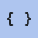

# byuwur/easy-code-viewer


**Code, let syntax speak.**

Display source with syntax highlighting, language selection, line numbers, wrapping, and copy controls.

Use it for documentation, examples, and read-only source panels. The separate `highlight()` API also works inside your own code blocks.

One JavaScript file. One scoped stylesheet. No build step. Plain JavaScript, with no runtime dependencies.

[Open the playground](https://byuwur.github.io/easy-code-viewer/)

Open `index.html` for the local playground; its page assets require internet access.

## Installation and usage

**Recommended: CDN.** No downloads or package manager.

```html
<link href="https://cdn.jsdelivr.net/gh/byuwur/easy-code-viewer@latest/code.min.css" rel="stylesheet" />
<script src="https://cdn.jsdelivr.net/gh/byuwur/easy-code-viewer@latest/code.min.js" defer></script>
<div id="viewer" data-theme="light"></div>
<script>
  document.addEventListener("DOMContentLoaded", () => {
    byCODEviewer(document.getElementById("viewer"), 'const greeting = "Hello";', {
      language: "javascript",
      lineNumbers: true,
      wordWrap: true
    });
  });
</script>
```

The CDN example uses `@latest` and requires internet access. Use a published tag or commit to pin a version.

**Local files:** For offline use, save `code.js` and `code.css` beside your HTML:

```html
<link href="code.css" rel="stylesheet" />
<script src="code.js" defer></script>
```

Exported HTML starters use default settings, independently of playground changes.

## API

`byCODEviewer(element, source?, options?)` accepts a string; omitted input uses the target's text. Invalid source/target types throw `TypeError`. Empty input displays one line; unsupported languages use plain text. Display splits LF/CRLF lines, while Copy preserves the source, including CR characters and final newlines. Size/token-limit errors display a message and resolve `ready` false.

`byCODEviewer.highlight(source, language = "plain", options = {})` synchronously returns a `DocumentFragment` with one `.byCODEhighlight` wrapper. Its textContent exactly preserves the source, including whitespace and CRLF. It creates no controls, changes no caller DOM, and never evaluates input.

`byCODEviewer.tokenize(source, language = "plain")` returns a lazy iterator of `{ type, text }` tokens using the same scanner. Joining their text reproduces the source exactly. Editors can consume it in short slices without creating a viewer or DOM. Validation and token-limit errors occur during iteration; the same highlighting limits apply.

```javascript
const tokens = byCODEviewer.tokenize("const answer = 42;\r\n", "js");
const original = [...tokens].map((token) => token.text).join("");
// Consuming all tokens here is synchronous; editors can iterate in scheduled slices.
```

Load `code.css` to style fragments, even without a viewer instance. Unthemed fragments inherit `--by-code-*` colors from any container; missing colors use Monokai Light.

Pass `{ theme: "dark", palette: "github" }` as the third argument to set the fragment's mode and palette, including unclassified text. Both options follow the viewer's validation rules. Omit them to inherit the host's colors.

You can also use `.light` / `.dark` with a named `data-theme` on the returned wrapper. The `data-theme="light"` / `"dark"` aliases remain supported. Explicit themes override inherited colors.

Pass `{ lineNumbers: true, statusBar: true }` as the third argument for a compact framed block. Both options default to `false` and work independently. Line numbers and status are presentation labels; `textContent` still preserves the exact source, including final newlines. Set `highlighting: false` to keep the language label without coloring tokens. The block creates no viewer instance, toolbar, or asynchronous lifecycle.

Invalid source/size throws `TypeError`/`RangeError` before returning a fragment. Unsupported languages use plain text.

```javascript
const code = document.querySelector("pre code");
const fragment = byCODEviewer.highlight(code.textContent, "javascript", { theme: "dark" });
code.replaceChildren(fragment);
```

`byCODEviewer.languages` is the frozen array of 80 canonical language names. Names and aliases are case-insensitive; surrounding whitespace is ignored. There is no automatic language detection. All languages are built in: no extra script, network lookup, or grammar dependency is needed.

The playground includes a source sample for every language, using the same canonical names as the viewer's language selector. Selecting a sample never executes its code.

## Code options

| Option           | Default   | Behavior                                                                    |
| ---------------- | --------- | --------------------------------------------------------------------------- |
| `language`       | `"plain"` | Canonical name or alias from the tables below. Unsupported names use plain. |
| `languageSelect` | `false`   | Show a language selector. Changing it supersedes unfinished rendering.      |
| `lineNumbers`    | `true`    | Show a separate, non-copying line-number gutter.                            |
| `wordWrap`       | `true`    | Wrap long lines; `false` keeps horizontal scrolling inside the viewer.      |

## Supported languages

| Family | Canonical languages |
| --- | --- |
| Web | HTML + CSS + JavaScript (`html`), JavaScript (`javascript`), TypeScript (`typescript`), JSX (`jsx`), TSX (`tsx`), CSS (`css`), SCSS (`scss`), Less (`less`), PHP + HTML (`php`) |
| Data | XML (`xml`), JSON (`json`), JSON with comments (`jsonc`), JSON5 (`json5`), YAML (`yaml`), SQL (`sql`), GraphQL (`graphql`), Protocol Buffers (`protobuf`) |
| Scripting | Python (`python`), Ruby (`ruby`), Perl (`perl`), Lua (`lua`) |
| Shell & build | Bash (`bash`), PowerShell (`powershell`), Windows Batch (`batch`), AWK (`awk`), Dockerfile (`dockerfile`), Makefile (`makefile`), CMake (`cmake`) |
| Systems | C (`c`), C++ (`cpp`), Go (`go`), Rust (`rust`), Zig (`zig`), D (`d`), Nim (`nim`), Solidity (`solidity`), Assembly (x86) (`assembly`), V (`v`), Odin (`odin`) |
| Application languages | C# (`csharp`), Java (`java`), Kotlin (`kotlin`), Scala (`scala`), Swift (`swift`), Objective-C (`objectivec`), Dart (`dart`), Groovy (`groovy`), Crystal (`crystal`), GDScript (`gdscript`), GameMaker Language (`gml`) |
| Scientific | R (`r`), Julia (`julia`), MATLAB (`matlab`), Fortran (`fortran`) |
| Functional | Haskell (`haskell`), Elixir (`elixir`), Erlang (`erlang`), F# (`fsharp`), OCaml (`ocaml`), Clojure (`clojure`), Common Lisp (`lisp`), Scheme (`scheme`), Racket (`racket`) |
| Classic | Pascal (`pascal`), COBOL (`cobol`), Visual Basic .NET (`vbnet`), Ada (`ada`) |
| Hardware & shaders | Verilog (`verilog`), SystemVerilog (`systemverilog`), VHDL (`vhdl`), GLSL (`glsl`), HLSL (`hlsl`), WGSL (`wgsl`) |
| Configuration | TOML (`toml`), INI (`ini`), Nginx (`nginx`), Terraform / HCL (`hcl`) |
| Documents | Markdown (`markdown`), Unified diff (`diff`), Plain text (`plain`) |

Common aliases include `js`, `ts`, `htm`, `py`, `sh`, `c++`/`cc`/`cxx`, `c#`/`cs`, `golang`, `rs`, `kt`, `objc`, `rb`, `pl`, `jl`, `ps1`/`pwsh`, `bat`/`cmd`, `hs`, `ex`, `erl`, `f#`/`fs`, `clj`, `ml`, `pas`, `f90`, `vb`, `sol`, `sv`, `vhd`, `frag`/`vert`, `gql`, `proto`, `tf`/`terraform`, `md`, `patch`, `asm`/`nasm`, and `gd`. `text`, `txt`, and `plaintext` select uncolored source. Unknown names also fall back to plain text.

## Stateful highlighting architecture

Language profiles provide keywords, literals, comment delimiters, quote rules, and common variable/directive forms to the shared scanner. Strings and comments own their contents before keyword matching. Lookup sets are created once; tokenization still yields original source slices lazily, with the existing source/token limits.

Dedicated boundaries handle HTML/XML, PHP inside an HTML host, JSX/TSX markup and brace expressions, Markdown, and unified diffs. JavaScript templates and JSX expressions share a nesting limit of 32. JSX text stays text, while braces return to the JavaScript or TypeScript scanner.

The scanner handles nested comments where applicable, Lua long brackets, Rust and Swift raw strings, C++ delimited raw strings, C# verbatim and variable-length raw strings, triple-quoted strings, Bash/Ruby heredocs, PowerShell here-strings, and Verilog based numbers. These are lexical rules, not compiler grammars. Raw-string boundaries follow the [Rust reference](https://doc.rust-lang.org/reference/tokens.html#raw-string-literals) and [C# reference](https://learn.microsoft.com/en-us/dotnet/csharp/language-reference/tokens/raw-string).

## Limits and known gaps

Lexical highlighting does not validate or format code. Ambiguous/incomplete syntax may be colored incorrectly; JavaScript regex/division detection uses heuristics.

The added languages provide lexical highlighting, not full parsing, validation, or compilation. Interpolation inside most non-JavaScript strings is colored as part of the string. Advanced macro systems, Ruby/Perl quote operators, MATLAB transpose ambiguity, fixed-column Fortran/COBOL, assembler dialects, and language-specific semantic rules are not resolved. Markdown coloring covers headings, lists, quotes, links, emphasis, inline code, and fenced regions; it does not replace easy-md-viewer.

JS decorators, Python f-string expression highlighting, Bash command-substitution parsing and full expansion support, SQL dialect extensions, PHP interpolation in strings, and YAML semantic validation remain outside the scanner. HTML script bodies use JavaScript regardless of `type`; style bodies use CSS. XML declarations/DTDs are colored as text; CSS selectors have no semantic resolution.

Limits: 2 million source characters, 20,000 LF-delimited display lines, 100,000 lexical tokens, 32 nested JS template-expression scanner levels. Rendering yields while processing token/line chunks and cancels obsolete work; an individual long token or string scan is synchronous. `.highlight()` is synchronous and builds a full fragment, so callers should keep code fences reasonably small.

All accepted lines are mounted; large snippets can create substantial DOMs.

Customize `--by-code-comment`, `--by-code-keyword`, `--by-code-string`, `--by-code-number`, `--by-code-property`, and `--by-code-tag` on `.byCODEdocument` or `.byCODEhighlight`, alongside the shared appearance options below. The returned fragment owns token colors; its caller owns typography, whitespace, theme selection, and block layout.

## Optional Markdown integration contract

Load `code.js` and `code.css` alongside `md.js` and `md.css` before rendering. [easy-md-viewer](https://github.com/byuwur/easy-md-viewer) uses `highlight()` for fenced blocks by default when available. Fence labels select the language; inline code stays plain. Use `{ codeHighlighting: false }` in the Markdown options to disable it.

Fragments inherit Markdown's palette, Light/Dark mode, and custom `--by-code-*` colors, including High Contrast. Markdown's `codeLineNumbers` and `codeStatusBar` options add the optional frame, gutter, and language/line-count row. No nested viewer instance or toolbar is created. Highlighting errors leave the original fence text intact, and Markdown works independently when this library is absent.

For other host pages, call `highlight(source, language)` and insert its fragment into your existing `<pre><code>`. The fragment API adds no controls or shared runtime state. No other viewer loads this library automatically.

[easy-md-editor](https://github.com/byuwur/easy-md-editor) uses `tokenize()` while editing and the Markdown viewer's `highlight()` integration in Preview. Load the companion scripts before creating the editor.

## Shared controls and lifecycle

| Option             | Default     | Behavior                                                                                                                                                   |
| ------------------ | ----------- | ---------------------------------------------------------------------------------------------------------------------------------------------------------- |
| `animations`       | `true`      | Brief control/disclosure motion and background fades; overrides the system motion preference.                                                              |
| `appearAnimation`  | `false`     | Fade and gently move the viewer in when `animations` is enabled. Initial rendering remains immediate by default.                                           |
| `toolbar`          | `true`      | Show the viewer header; secondary tools are configured separately.                                                                                         |
| `credits`          | `true`      | Show attribution in the header.                                                                                                                            |
| `displayContainer` | `true`      | Show the content panel frame and inner horizontal padding. `false` also hides status information.                                                          |
| `statusBar`        | `true`      | Show counts and metadata when `displayContainer` is true. With `statusBar: false`, loading and empty results remain visible; errors always remain visible. |
| `wrapControl`      | `false`     | Show the word-wrap switch; wordWrap also works without it.                                                                                                 |
| `theme`            | Container   | Initial `"light"` or `"dark"` mode class.                                                                                                                  |
| `palette`          | Container   | Initial `data-theme` palette, including custom CSS names.                                                                                                  |
| `fontSize`         | Container   | Number in rem or a CSS size such as `"1.25em"` or `"20px"`; bounded to `0.5rem`–`3rem`.                                                                    |
| `themeToggle`      | `true`      | Show the theme toggle.                                                                                                                                     |
| `fontSizeControls` | `true`      | Show text-size controls.                                                                                                                                   |
| `copyButton`       | `true`      | Show full source copy button.                                                                                                                              |
| `controlsSize`     | `"regular"` | `"xs"` (0.5rem), `"small"` (0.7rem), `"regular"` (0.875rem), `"large"` (1rem), or `"xl"` (1.25rem); invalid values use `"regular"`.                        |
| `controlsCompact`  | `true`      | Keep credits beside controls; `false` stacks them. Wraps as needed.                                                                                        |
| `controlsPosition` | `"top"`     | Sticky `"top"` or `"bottom"` toolbar; invalid values use `"top"`.                                                                                          |

The controller exposes `ready` and `destroy()`. `ready` resolves `true` after initial rendering, or `false` on a displayed data error or cancellation. Invalid targets/options can throw synchronously.

`ready` describes the initial render only; it does not track later language selections.

```javascript
const viewer = byCODEviewer(target, source, { language: "js" });
const rendered = await viewer.ready; // false on data errors or cancellation.
viewer.destroy(); // Call when the host panel is removed.
```

Re-rendering disposes the previous instance. `destroy()` cancels pending work and clears the target only if the instance still owns it. Duplicate script loads preserve the API. Read its version with `byCODEviewer.VERSION`.

Input is displayed as text, never executed. Style `.byCODEdocument` with `--by-view-bg`, `--by-view-text`, `--by-view-muted`, `--by-view-border`, `--by-view-accent`, `--by-view-alt`, `--by-view-string`, and `--by-view-literal`. The container uses system-ui; source/tree content uses monospace. Override the class or target's inline font/size as needed.

Copy requires clipboard permission in a secure context.

Requires a modern browser with async functions, WeakMap, ES2022 array methods, and CSS variables. Tests run in Chromium; other engines are unverified.

`--by-view-content-font` and `--by-view-line-height` set source/tree typography.

The playground disables header-only settings while Viewer header is off, preserving their values. Appearing animation is disabled while Animations is off.

Use `toolbar: false` to hide the header, or disable `credits`, `themeToggle`, `fontSizeControls`, and `copyButton` individually. Content actions such as search and format-specific buttons use their own options.

Controls use monospace by default; override `--by-view-controls-font` to change it.

## Themes

Configure appearance in the options object or on the container:

```javascript
byCODEviewer(target, source, {
  theme: "dark",
  palette: "github",
  fontSize: 1.125
});
```

`theme` sets the mode class; `palette` sets `data-theme`. `fontSize` numbers use rem (`1` = the root text size); CSS sizes such as `"1.25em"`, `"1.25rem"`, and `"20px"` are also accepted. All sizes stay between `0.5rem` and `3rem`. Explicit options override markup; omitted or `null` values retain the container's settings. A named palette preserves its existing mode, including the `data-theme="light"` / `"dark"` aliases. Invalid appearance values throw `RangeError` before replacing the current document. Text-size Reset returns to the configured size, including after re-rendering.

Initial content appears immediately unless `appearAnimation: true` is requested with animations enabled. Theme backgrounds fade briefly on shared surfaces; font size, rows, and syntax tokens change immediately. High Contrast and forced-color backgrounds switch immediately. Animations also affect controls and deliberate show/hide actions. Disclosure size/exit transitions progressively enhance browsers that support them.

The outer document and inner surfaces have independent CSS backgrounds. Both follow the selected theme unless overridden. Set `--by-view-document-bg: #0000` to reveal the host page while keeping content panels and individual controls readable. `--by-view-container-bg` sets the shared background of those panels and controls; it also accepts alpha colors or `transparent`. The toolbar and credits have no background. These overrides survive theme changes.

```css
.byCODEdocument {
  --by-view-document-bg: #0000;
}
```

The playground uses SPA.js's Pickr assets for color and opacity, with text inputs when Pickr is unavailable. **Copy CSS** exports the appearance overrides; clear a field to restore its theme default. The renderer needs no color-picker dependency.

**48 palettes, each with Light and Dark modes.** Monokai, GitHub, Solarized, and High Contrast are included in `code.css`. Load the optional `code.themes.css` after it for the other 44 skins:

```html
<link rel="stylesheet" href="https://cdn.jsdelivr.net/gh/byuwur/easy-code-viewer@latest/code.themes.min.css" />
```

For local use, save `code.themes.css` beside `code.css`. The playground loads both stylesheets; default HTML starters use the core stylesheet. Known extra presets without the pack fall back to the current mode and emit a one-time `console.warn` naming the required file. Custom CSS names do not need the pack.

The picker groups palettes into Essentials, Editor classics, App inspired, Colorful, and Reading & nature. Palette definitions remain at the end of each stylesheet.

| Palette              | `data-theme`           | What it looks like                             |
| -------------------- | ---------------------- | ---------------------------------------------- |
| Monokai (default)    | `monokai`              | Warm light and dark colors; the default.       |
| GitHub               | `github`               | Neutral GitHub surfaces and syntax.            |
| Solarized            | `solarized`            | Warm paper and deep blue-green surfaces.       |
| High Contrast        | `high-contrast`        | Strong text, borders, and focus indicators.    |
| Dracula              | `dracula`              | Purple with vivid pink, green, and cyan.       |
| Darcula              | `darcula`              | Charcoal surfaces and warm IDE accents.        |
| Nord                 | `nord`                 | Arctic blues and snowy neutral surfaces.       |
| Catppuccin           | `catppuccin`           | Latte and Mocha with soft mauve accents.       |
| Catppuccin Frappé    | `catppuccin-frappe`    | Cooler Catppuccin with a blue accent.          |
| Catppuccin Macchiato | `catppuccin-macchiato` | Catppuccin with a warm pink accent.            |
| Rosé Pine            | `rose-pine`            | Dawn and Pine with dusty rose accents.         |
| Rosé Pine Moon       | `rose-pine-moon`       | A duskier violet take on Rosé Pine.            |
| Gruvbox              | `gruvbox`              | Warm retro browns, olive, and orange.          |
| Gruvbox Material     | `gruvbox-material`     | Softer earthy surfaces and muted greens.       |
| Tokyo Night          | `tokyo-night`          | Tokyo Day and Night with electric blues.       |
| Tokyo Storm          | `tokyo-storm`          | A brighter blue-gray Tokyo evening.            |
| Tokyo Moon           | `tokyo-moon`           | Indigo nights and luminous lavender.           |
| One                  | `one`                  | Clean One Light and One Dark colors.           |
| Material             | `material`             | Blue-gray material surfaces and cyan.          |
| Material Ocean       | `material-ocean`       | Deep navy with soft fluorescent accents.       |
| Night Owl            | `night-owl`            | Little Light and deep-blue night colors.       |
| Synthwave            | `synthwave`            | Neon magenta and cyan with no glow effects.    |
| Ayu                  | `ayu`                  | Warm amber over light paper or dark navy.      |
| Everforest           | `everforest`           | Soft forest greens and cream.                  |
| Kanagawa             | `kanagawa`             | Ink, old paper, and Japanese wave colors.      |
| Selenized            | `selenized`            | Balanced teal surfaces and restrained color.   |
| VS Code              | `vscode`               | Familiar neutral editor surfaces and blue.     |
| Monokai Dimmed       | `monokai-dimmed`       | Quieter charcoal and desaturated Monokai.      |
| Discord              | `discord`              | Blurple accents and familiar chat surfaces.    |
| Slack                | `slack`                | Aubergine, warm pink, and friendly teal.       |
| BONYUR               | `bonyur`               | Signature teal and pink over warm neutral ink. |
| Sakura               | `sakura`               | Cherry-blossom pink from surface to syntax.    |
| Bubblegum            | `bubblegum`            | Saturated hot-pink surfaces and cyan accents.  |
| Candy                | `candy`                | Pink and mint with playful lavender syntax.    |
| Rose Gold            | `rose-gold`            | Dusty pink and warm copper.                    |
| Lavender             | `lavender`             | Lilac surfaces with deep violet accents.       |
| Cyberpunk            | `cyberpunk`            | Acid yellow, electric cyan, and magenta.       |
| Sunset               | `sunset`               | Burnt orange, coral, and evening purple.       |
| Volcano              | `volcano`              | Lava reds over warm ash.                       |
| Amber                | `amber`                | Golden amber inspired by old displays.         |
| Terminal             | `terminal`             | Phosphor greens on near-black.                 |
| Paper                | `paper`                | Warm cream, brown ink, and quiet margins.      |
| Ink                  | `ink`                  | Grayscale surfaces and restrained syntax.      |
| Ocean                | `ocean`                | Deep ocean blue and clear turquoise.           |
| Forest               | `forest`               | Rich green surfaces and mossy accents.         |
| Mint                 | `mint`                 | Fresh mint surfaces and cool teal.             |
| Ice                  | `ice`                  | Glacial blue, crisp whites, and silver.        |
| Sepia                | `sepia`                | Aged parchment and warm brown ink.             |

Editor and app skins are inspired adaptations, including light counterparts where needed; colors are adjusted for readable text and controls rather than exact replicas. All palettes use the same layout and need no assets beyond the core stylesheet and optional theme pack.

Use a mode class and a palette name together:

```html
<div id="viewer" class="dark" data-theme="github"></div>
<!-- High Contrast Light: class="light" data-theme="high-contrast" -->
<!-- High Contrast Dark: class="dark" data-theme="high-contrast" -->
```

Rendering adds `.byCODEdocument`; its variables affect only that container and its children. The theme switch changes mode while keeping the palette; re-rendering preserves both. A named palette without a mode class starts in Light; if both mode classes are present, Dark wins.

`data-theme="light"` and `data-theme="dark"` select Monokai and override mode classes. A mode class alone, or no explicit theme, also uses Monokai.

### High Contrast

High Contrast text colors target at least [7:1 contrast](https://www.w3.org/WAI/WCAG22/Understanding/contrast-enhanced.html), with [3:1 contrast for control boundaries and focus cues](https://www.w3.org/WAI/WCAG22/Understanding/non-text-contrast.html). Check contrast again when you override colors.

### Make it yours

The playground's **Custom theme CSS** field edits both modes of the selected palette. Export those rules to your own stylesheet and use `data-theme="custom"` with `class="light"` or `class="dark"`. Custom drafts stay in the playground; the renderer does not store them.

Define a named palette after the viewer stylesheet. Unspecified colors inherit Monokai:

```css
.byCODEdocument.light[data-theme="my-ocean"] {
  --by-view-bg: #f3f8fc;
  --by-view-text: #102a43;
  --by-view-border: #486581;
  --by-view-accent: #005a9c;
}

.byCODEdocument.dark[data-theme="my-ocean"] {
  --by-view-bg: #102a43;
  --by-view-text: #f0f6fc;
  --by-view-border: #9fb3c8;
  --by-view-accent: #8cd3ff;
}
```

```html
<div id="viewer" class="dark" data-theme="my-ocean"></div>
```

Named palettes need no JavaScript registration or extra theme files. Standalone `.byCODEhighlight` wrappers accept the same mode classes and palettes.

In the playground configuration, `theme` is the mode, `palette` is its name, and `customThemeCSS` holds custom rules. Null appearance values inherit defaults. Pass only documented API options to the renderer.

**Copy CSS** exports typography and individual color overrides. Inline colors override palette variables; clear them or Reset to restore palette defaults.

Text-size controls change only this viewer, in `0.125rem` steps from `0.5rem` to `3rem`, independently of button size. **A** restores its initial size; re-rendering preserves the selected size.

### Legacy theme links

Legacy integrations can use `#byVIEWtheme` or a detected `code.light.css` / `code.dark.css` link. The toggle keeps its path, query, and hash and updates viewers sharing the link. Explicit container themes stay independent. Separate theme files are no longer shipped; retain your hosted legacy files to use this alternative.

## Checks

Theme tests cover both modes, container isolation, legacy links, custom CSS, and High Contrast. Clipboard tests use stubs; they do not verify real permissions.

Playground tests fetch the pinned Bootstrap stylesheet unless `BOOTSTRAP_CSS_PATH` points to a cached copy.

Install Playwright outside the repository and set `NODE_PATH` to its `node_modules` directory:

```sh
node --check code.js
node --test tests/rendering.cjs   # Library
node --test tests/playground.cjs  # Playground
```

`BROWSER_CHANNEL=chrome` uses installed Chrome; `CHROMIUM_EXECUTABLE_PATH` selects a Chromium executable. Otherwise, install Playwright Chromium. [GitHub Actions](.github/workflows/rendering.yml) reports Library and Playground as independent jobs; a failed suite does not cancel the other.

## The easy viewers

Need another format, maybe an editor? Explore the family:

<a href="https://byuwur.github.io/easy-md-viewer/"> MD</a> ·
<a href="https://byuwur.github.io/easy-md-editor/"> MD.edit</a> ·
<a href="https://byuwur.github.io/easy-code-viewer/"> CODE</a> ·
<a href="https://byuwur.github.io/easy-json-viewer/"> JSON</a> ·
<a href="https://byuwur.github.io/easy-csv-viewer/"> CSV</a> ·
<a href="https://byuwur.github.io/easy-diff-viewer/"> DIFF</a> ·
<a href="https://byuwur.github.io/easy-log-viewer/"> LOG</a> ·
<a href="https://byuwur.github.io/easy-xml-viewer/"> XML</a> ·
<a href="https://byuwur.github.io/easy-yaml-viewer/"> YAML</a>

## License

MIT (c) 2026 Andres Trujillo [Mateus] byUwUr. See [LICENSE](LICENSE).

[](https://deepwiki.com/byuwur/easy-code-viewer)
