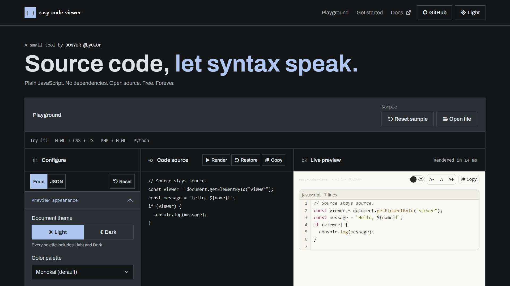

# byuwur/easy-code-viewer



**Code, let syntax speak.**

Display source with syntax highlighting, language selection, line numbers, wrapping, and copy controls.

Use it for documentation, examples, and read-only source panels. The separate `highlight()` API also works inside your own code blocks.

One JavaScript file. One scoped stylesheet. No build step. Plain JavaScript, with no runtime dependencies.

[Open the playground](https://byuwur.github.io/easy-code-viewer/)

Open `index.html` for the local playground; its page assets require internet access.

## Installation and usage

**Recommended: CDN.** No downloads or package manager.

```html
<link href="https://cdn.jsdelivr.net/gh/byuwur/easy-code-viewer@latest/code.css" rel="stylesheet" />
<script src="https://cdn.jsdelivr.net/gh/byuwur/easy-code-viewer@latest/code.js" defer></script>
<div id="viewer" data-theme="light"></div>
<script>
  document.addEventListener("DOMContentLoaded", () => {
    byCODEviewer(document.getElementById("viewer"), 'const greeting = "Hello";', {
      language: "javascript",
      lineNumbers: true,
      wordWrap: true
    });
  });
</script>
```

The CDN example uses `@latest` and requires internet access. Use a published tag or commit to pin a version.

**Local files:** For offline use, save `code.js` and `code.css` beside your HTML:

```html
<link href="code.css" rel="stylesheet" />
<script src="code.js" defer></script>
```

Exported HTML starters use default settings, independently of playground changes.

## API

`byCODEviewer(element, source?, options?)` accepts a string; omitted input uses the target's text. Invalid source/target types throw `TypeError`. Empty input displays one line; unsupported languages use plain text. Display splits LF/CRLF lines, while Copy preserves the source, including CR characters and final newlines. Size/token-limit errors display a message and resolve `ready` false.

`byCODEviewer.highlight(source, language = "plain", options = {})` synchronously returns a `DocumentFragment` with one `.byCODEhighlight` wrapper. Its textContent exactly preserves the source, including whitespace and CRLF. It creates no controls, changes no caller DOM, and never evaluates input.

`byCODEviewer.tokenize(source, language = "plain")` returns a lazy iterator of `{ type, text }` tokens using the same scanner. Joining their text reproduces the source exactly. Editors can consume it in short slices without creating a viewer or DOM. Validation and token-limit errors occur during iteration; the same highlighting limits apply.

```javascript
const tokens = byCODEviewer.tokenize("const answer = 42;\r\n", "js");
const original = [...tokens].map((token) => token.text).join("");
// Consuming all tokens here is synchronous; editors can iterate in scheduled slices.
```

Load `code.css` to style fragments, even without a viewer instance. Unthemed fragments inherit `--by-code-*` colors from any container; missing colors use Monokai Light.

For an explicit palette, use `.light` / `.dark` with a named `data-theme` on the returned wrapper, just like a full viewer. This overrides inherited colors. The `data-theme="light"` / `"dark"` aliases also work.

Pass `{ lineNumbers: true, statusBar: true }` as the third argument for a compact framed block. Both options default to `false` and work independently. Line numbers and status are presentation labels; `textContent` still preserves the exact source, including final newlines. Set `highlighting: false` to keep the language label without coloring tokens. The block creates no viewer instance, toolbar, or asynchronous lifecycle.

Invalid source/size throws `TypeError`/`RangeError` before returning a fragment. Unsupported languages use plain text.

```javascript
const code = document.querySelector("pre code");
const fragment = byCODEviewer.highlight(code.textContent, "javascript");
fragment.firstElementChild.dataset.theme = "dark";
code.replaceChildren(fragment);
```

`byCODEviewer.languages` is the frozen canonical language-name array. Supported aliases: `js`, `ts`, `htm`, `yml`, `py`, `sh`, `shell`, `text`, and `txt`. Names are case-insensitive. No automatic language detection is attempted.

## Code options

| Option           | Default   | Behavior                                                                    |
| ---------------- | --------- | --------------------------------------------------------------------------- |
| `language`       | `"plain"` | Canonical name or alias from the tables below. Unsupported names use plain. |
| `languageSelect` | `false`   | Show a language selector. Changing it supersedes unfinished rendering.      |
| `lineNumbers`    | `true`    | Show a separate, non-copying line-number gutter.                            |
| `wordWrap`       | `true`    | Wrap long lines; `false` keeps horizontal scrolling inside the viewer.      |

## Stateful highlighting architecture

The scanner processes original source slices; strings, comments, heredocs, and raw regions take precedence over keywords/operators. Profiles share a script scanner, while markup and PHP composition use separate scanners. JavaScript template expressions recurse within a depth bound.

Extend a profile when lexical rules fit; use a separate scanner for a different syntax/context boundary.

| Stage | Languages | Implemented lexical behavior |
| --- | --- | --- |
| 1 | HTML, CSS, JavaScript | Tags/attributes/entities, CSS properties/units/colors/at-rules, comments, strings, numbers, keywords/operators, JS regex literals and nested template expressions. HTML script/style bodies use JS/CSS scanners. |
| 2 | JSON, XML, YAML | Quoted JSON keys/literals, XML namespaces/comments/CDATA/PI, YAML keys/quotes/anchors/aliases/block scalars. These highlight source without parsing/validating it. |
| 3 | PHP with HTML/CSS/JS | PHP strings/comments/variables/keywords/heredoc/nowdoc, including server blocks inside host attributes and script/style bodies. PHP regions are lexed, masked while scanning the host, then overlaid without changing source offsets. Snippets without opening tags use the PHP scanner directly. |
| 4 | SQL, Python, Bash, TypeScript | SQL strings/quoted identifiers/dollar quotes/nested block comments; Python strings/triple strings/prefixes/comments; Bash strings/variables/simple heredocs/comments; TypeScript's additional keywords with JS lexical context. |

## Limits and known gaps

Lexical highlighting does not validate or format code. Ambiguous/incomplete syntax may be colored incorrectly; JavaScript regex/division detection uses heuristics.

Unsupported: JSX/TSX, JS decorators, Python f-string expression highlighting, Bash command-substitution parsing and full expansion support, SQL dialect extensions, PHP interpolation in strings, and YAML semantic tag/indent validation. HTML script bodies always use JavaScript regardless of `type`. XML declarations/DTDs are colored as text; CSS selectors have no semantic resolution.

Limits: 2 million source characters, 20,000 LF-delimited display lines, 100,000 lexical tokens, 32 nested JS template-expression scanner levels. Rendering yields while processing token/line chunks and cancels obsolete work; an individual long token or string scan is synchronous. `.highlight()` is synchronous and builds a full fragment, so callers should keep code fences reasonably small.

All accepted lines are mounted; large snippets can create substantial DOMs.

Customize `--by-code-comment`, `--by-code-keyword`, `--by-code-string`, `--by-code-number`, `--by-code-property`, and `--by-code-tag` on `.byCODEdocument` or `.byCODEhighlight`, alongside the shared appearance options below. The returned fragment owns token colors; its caller owns typography, whitespace, theme selection, and block layout.

## Optional Markdown integration contract

Load `code.js` and `code.css` alongside `md.js` and `md.css` before rendering. [easy-md-viewer](https://github.com/byuwur/easy-md-viewer) uses `highlight()` for fenced blocks by default when available. Fence labels select the language; inline code stays plain. Use `{ codeHighlighting: false }` in the Markdown options to disable it.

Fragments inherit Markdown's palette, Light/Dark mode, and custom `--by-code-*` colors, including High Contrast. Markdown's `codeLineNumbers` and `codeStatusBar` options add the optional frame, gutter, and language/line-count row. No nested viewer instance or toolbar is created. Highlighting errors leave the original fence text intact, and Markdown works independently when this library is absent.

For other host pages, call `highlight(source, language)` and insert its fragment into your existing `<pre><code>`. The fragment API adds no controls or shared runtime state. No other viewer loads this library automatically.

[easy-md-editor](https://github.com/byuwur/easy-md-editor) uses `tokenize()` while editing and the Markdown viewer's `highlight()` integration in Preview. Load the companion scripts before creating the editor.

## Shared controls and lifecycle

| Option             | Default     | Behavior                                                                     |
| ------------------ | ----------- | ---------------------------------------------------------------------------- |
| `toolbar`          | `true`      | Show the viewer header; secondary tools are configured separately.           |
| `credits`          | `true`      | Show attribution in the header.                                              |
| `statusBar`        | `true`      | Show counts and metadata. Loading, errors, and empty results remain visible. |
| `wrapControl`      | `false`     | Show the word-wrap switch; wordWrap also works without it.                   |
| `themeToggle`      | `true`      | Show the theme toggle.                                                       |
| `fontSizeControls` | `true`      | Show text-size controls.                                                     |
| `copyButton`       | `true`      | Show full source copy button.                                                |
| `controlsSize`     | `"regular"` | `"small"`, `"regular"`, or `"large"`; invalid values use `"regular"`.        |
| `controlsCompact`  | `true`      | Keep credits beside controls; `false` stacks them. Wraps as needed.          |
| `controlsPosition` | `"top"`     | Sticky `"top"` or `"bottom"` toolbar; invalid values use `"top"`.            |

The controller exposes `ready` and `destroy()`. `ready` resolves `true` after initial rendering, or `false` on a displayed data error or cancellation. Invalid targets/options can throw synchronously.

`ready` describes the initial render only; it does not track later language selections.

```javascript
const viewer = byCODEviewer(target, source, { language: "js" });
const rendered = await viewer.ready; // false on data errors or cancellation.
viewer.destroy(); // Call when the host panel is removed.
```

Re-rendering disposes the previous instance. `destroy()` cancels pending work and clears the target only if the instance still owns it. Duplicate script loads preserve the API. Read its version with `byCODEviewer.VERSION`.

Input is displayed as text, never executed. Style `.byCODEdocument` with `--by-view-bg`, `--by-view-text`, `--by-view-muted`, `--by-view-border`, `--by-view-accent`, `--by-view-alt`, `--by-view-string`, and `--by-view-literal`. The container uses system-ui; source/tree content uses monospace. Override the class or target's inline font/size as needed.

Copy requires clipboard permission in a secure context.

Requires a modern browser with async functions, WeakMap, ES2022 array methods, and CSS variables. Tests run in Chromium; other engines are unverified.

`--by-view-content-font` and `--by-view-line-height` set source/tree typography.

Use `toolbar: false` to hide the header, or disable `credits`, `themeToggle`, `fontSizeControls`, and `copyButton` individually. Content actions such as search and format-specific buttons use their own options.

Controls use monospace by default; override `--by-view-controls-font` to change it.

## Themes

`code.css` includes all palettes in Light and Dark. Monokai is the default.

| Palette           | `data-theme`    | What it looks like                                                |
| ----------------- | --------------- | ----------------------------------------------------------------- |
| Monokai (default) | `monokai`       | Warm light and dark colors.                                       |
| GitHub            | `github`        | Familiar neutral surfaces and syntax colors.                      |
| Solarized         | `solarized`     | Warm light or deep blue-green dark surfaces.                      |
| High Contrast     | `high-contrast` | Black/white surfaces, strong text, borders, and focus indicators. |

Use a mode class and a palette name together:

```html
<div id="viewer" class="dark" data-theme="github"></div>
<!-- High Contrast Light: class="light" data-theme="high-contrast" -->
<!-- High Contrast Dark: class="dark" data-theme="high-contrast" -->
```

Rendering adds `.byCODEdocument`; its variables affect only that container and its children. The theme switch changes mode while keeping the palette; re-rendering preserves both. A named palette without a mode class starts in Light; if both mode classes are present, Dark wins.

`data-theme="light"` and `data-theme="dark"` select Monokai and override mode classes. A mode class alone, or no explicit theme, also uses Monokai.

### High Contrast

High Contrast text colors target at least [7:1 contrast](https://www.w3.org/WAI/WCAG22/Understanding/contrast-enhanced.html), with [3:1 contrast for control boundaries and focus cues](https://www.w3.org/WAI/WCAG22/Understanding/non-text-contrast.html). Check contrast again when you override colors.

### Make it yours

The playground's **Custom theme CSS** field edits both modes of the selected palette. Export those rules to your own stylesheet and use `data-theme="custom"` with `class="light"` or `class="dark"`. Custom drafts stay in the playground; the renderer does not store them.

Define a named palette after the viewer stylesheet. Unspecified colors inherit Monokai:

```css
.byCODEdocument.light[data-theme="ocean"] {
  --by-view-bg: #f3f8fc;
  --by-view-text: #102a43;
  --by-view-border: #486581;
  --by-view-accent: #005a9c;
}

.byCODEdocument.dark[data-theme="ocean"] {
  --by-view-bg: #102a43;
  --by-view-text: #f0f6fc;
  --by-view-border: #9fb3c8;
  --by-view-accent: #8cd3ff;
}
```

```html
<div id="viewer" class="dark" data-theme="ocean"></div>
```

Named palettes need no JavaScript registration or extra theme files. Standalone `.byCODEhighlight` wrappers accept the same mode classes and palettes.

In the playground configuration, `theme` is the mode, `palette` is its name, and `customThemeCSS` holds custom rules. Null appearance values inherit defaults. Pass only documented API options to the renderer.

**Copy CSS** exports typography and individual color overrides. Inline colors override palette variables; clear them or Reset to restore palette defaults.

Text-size controls change only this viewer, in `0.125rem` steps from `0.5rem` to `3rem`, independently of button size. **A** restores its initial size; re-rendering preserves the selected size.

### Legacy theme links

Legacy integrations can use `#byVIEWtheme` or a detected `code.light.css` / `code.dark.css` link. The toggle keeps its path, query, and hash and updates viewers sharing the link. Explicit container themes stay independent. Separate theme files are no longer shipped; retain your hosted legacy files to use this alternative.

## Checks

Theme tests cover both modes, container isolation, legacy links, custom CSS, and High Contrast. Clipboard tests use stubs; they do not verify real permissions.

Landing tests fetch the pinned Bootstrap stylesheet unless `BOOTSTRAP_CSS_PATH` points to a cached copy.

Install Playwright outside the repository and set `NODE_PATH` to its `node_modules` directory:

```sh
node --check code.js
node --test tests/rendering.cjs
```

`BROWSER_CHANNEL=chrome` uses installed Chrome; `CHROMIUM_EXECUTABLE_PATH` selects a Chromium executable. Otherwise, install Playwright Chromium. [GitHub Actions](.github/workflows/rendering.yml) runs the same suite.

## The easy viewers

Need another format, or a Markdown editor? Explore the family:

[Markdown](https://github.com/byuwur/easy-md-viewer) · [JSON](https://github.com/byuwur/easy-json-viewer) · [CSV & TSV](https://github.com/byuwur/easy-csv-viewer) · [Logs](https://github.com/byuwur/easy-log-viewer) · [Diff](https://github.com/byuwur/easy-diff-viewer) · [XML](https://github.com/byuwur/easy-xml-viewer) · [YAML](https://github.com/byuwur/easy-yaml-viewer) · [Source code](https://github.com/byuwur/easy-code-viewer)

[Write Markdown with easy-md-editor](https://github.com/byuwur/easy-md-editor).

## License

MIT (c) 2026 Andres Trujillo [Mateus] byUwUr. See [LICENSE](LICENSE).
